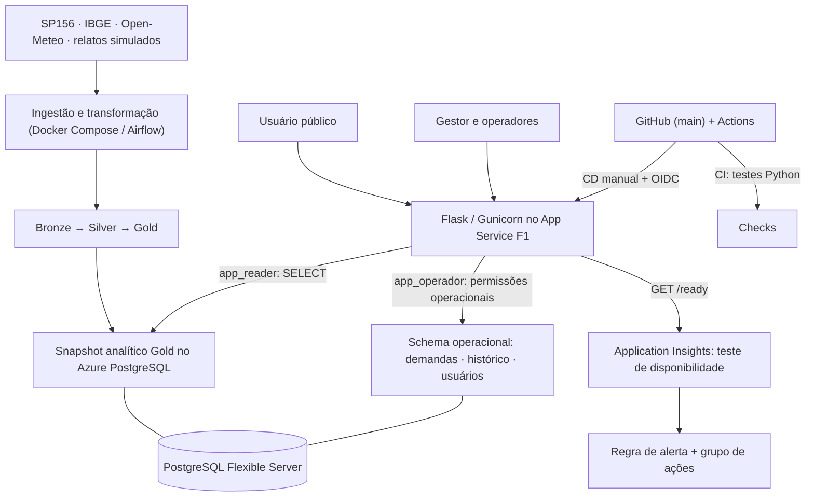

# Etapa 12 — Arquitetura e documentação técnica da entrega Cloud

**Projeto:** Fila Justa — MVP acadêmico de priorização urbana e gestão de demandas  
**Repositório:** [MateusTibao/fila-justa-mvp](https://github.com/MateusTibao/fila-justa-mvp)  
**Aplicação:** https://app-fila-justa-4b9b51.azurewebsites.net  
**Referência da documentação:** 18/11/2026  
**Escopo:** arquitetura efetivamente validada, procedimentos de operação e limitações conhecidas. Não substitui evidências de novas execuções.

## 1. Visão geral

O Fila Justa combina uma **fila analítica de priorização territorial** com uma **central operacional de demandas**. São funções distintas: o processamento dos dados gera a priorização; a central recebe manualmente demandas ou importa ocorrências selecionadas da fila, acompanhando o atendimento sem alterar as classificações históricas da Gold.

A implantação do MVP utiliza **Azure App Service Linux F1**, **Azure Database for PostgreSQL Flexible Server** e **Application Insights**. O código do aplicativo e os workflows ficam no **GitHub**; o deploy para Azure é **manual e autenticado por OIDC**.

O processamento Bronze/Silver/Gold foi desenvolvido e validado no ambiente de engenharia de dados com Docker Compose e Airflow. Na Azure foi carregado um **snapshot das estruturas Gold** para consulta. **Não há evidência de que o Airflow ou todas as ingestões estejam executando continuamente na Azure**; não representar esse processamento como serviço cloud permanente.

## 2. Diagrama lógico

**Leitura do diagrama:** o aplicativo e o PostgreSQL usam conexão de rede permitida pelo firewall com a exceção para serviços Azure; **não há uma VNet privada entre eles**. O Application Insights faz a verificação HTTP periódica; o resultado do envio de notificação por e-mail não foi comprovado.

## 3. Recursos e ambientes

| Componente | Recurso / configuração | Papel |
|---|---|---|
| Assinatura | Azure for Students | Limites de cota e cobrança estudantil |
| Resource Group | `rg-fila-justa` | Organização dos recursos |
| Hospedagem | `asp-fila-justa` · App Service F1 · North Central US | Plano gratuito de aplicação |
| Aplicação | `app-fila-justa-4b9b51` · Python 3.12 · Flask/Gunicorn | Site público e gestão autenticada |
| Banco | `psql-fila-justa-4b9b51` · PostgreSQL 16 · North Central US | Gold e dados operacionais |
| Database | `fila_justa` | Schemas `gold` e `operacional` |
| Observabilidade | Application Insights `app-fila-justa` | Requisições, disponibilidade e diagnósticos |
| Monitoramento | `fj-disponibilidade-banco` em `/ready` | Teste de disponibilidade da aplicação com banco |
| Notificações | `fj-alertas-disponibilidade` | Grupo de ações vinculado à regra |
| Código | `MateusTibao/fila-justa-mvp` | Branch `main`, testes e deploy manual |

**Separação dos ambientes:** os testes de regras e persistência usam Python/pytest e banco de testes em memória onde previsto; os testes funcionais da implantação foram realizados na aplicação Azure com conta gestora de demonstração. O repositório contém o código do MVP e as migrações operacionais; a configuração de acesso ao banco permanece fora do Git.

## 4. Origem e tratamento dos dados

Fontes utilizadas no pipeline de engenharia: **SP156 (2026), dados distritais do IBGE, previsão meteorológica do Open-Meteo e relatos simulados de aplicativo**. O processamento original padroniza, filtra e agrega ocorrências, com vinculação territorial e identificação de agrupamentos.

Validações registradas durante o desenvolvimento:

| Marco | Resultado |
|---|---|
| SP156 2026, trimestres 1–3 publicados | 1.525.907 registros carregados na Bronze |
| IBGE distrital | 96 distritos; população e domicílios conferidos na fonte utilizada |
| Relatos simulados | 889 registros |
| Clima, fotografia de 12/11/2026 | 4.608 registros relativos a 96 distritos |
| Silver | 16.553 ocorrências válidas |
| Agrupamentos | 11.163 clusters |
| Gold no banco Azure | 11.163 registros em `gold.mart_fila_priorizacao` na validação da migração |

**Limitação temporal:** o ano de 2026 ainda não havia sido integralmente publicado na fonte SP156 quando a carga foi feita; foram usados os trimestres disponíveis (1–3). Os resultados são um retrato da execução validada, não uma garantia de atualização automática em tempo real.

A fila pública consulta as **primeiras 30 posições** por prioridade. Um registro Gold só entra na gestão operacional mediante seleção/importação específica. A importação usa `cluster_id` como referência e impede duplicidade do mesmo agrupamento.

## 5. Persistência e regras operacionais

### Banco analítico: `gold`

A aplicação pública lê `gold.mart_fila_priorizacao` usando **`app_reader` (somente SELECT)**. Essa conta não executa migrações nem alterações na fila.

### Banco operacional: `operacional`

O schema contém:

- `demandas`: identificador, origem, `cluster_id` opcional, campos descritivos, estado, prazo, timestamps e controle de versão.
- `historico_status`: eventos de criação, edição e transição, com autor, instante, justificativa e nova versão.
- `usuarios`: credenciais com hash, identidade, perfil e ativação.

O usuário **`app_operador`** pode consultar os registros necessários, inserir/alterar demandas e inserir eventos de histórico, mas **não pode cadastrar usuários nem atualizar a Gold**. Provisionamento de contas exige identidade administrativa separada, usada de forma pontual, não no processo web.

Os estados operacionais são `nova`, `pendente`, `em_andamento`, `aguardando_validacao`, `resolvida` e `cancelada`. Conclusão, cancelamento e reabertura exigem justificativa e perfil autorizado. Conflitos de versão retornam **HTTP 409**.

A camada analítica não sofre alterações quando uma demanda é movida ou concluída. A reimportação de `cluster_id` já conhecido deve preservar identificação, estado, versão e histórico.

## 6. Aplicação e endpoints

| Endereço | Função |
|---|---|
| `/` | Exibição pública das 30 primeiras posições Gold |
| `/health` | Saúde do processo Flask; não consulta o banco |
| `/ready` | Consulta de prontidão do PostgreSQL; 503 se indisponível |
| `/login` | Autenticação do perfil operacional |
| `/gestao/kanban` | Quadro de acompanhamento |
| `/gestao/demandas` | Lista, busca e filtros |
| `/gestao/dashboard` | Indicadores operacionais |

A API autenticada fica sob `/api/gestao`, aplica autorização por perfil e exige proteção CSRF em modificações. As sessões usam cookies seguros e segredo mantido nas configurações da Azure.

## 7. Entrega contínua e publicação

- **CI:** `.github/workflows/ci.yml`. Executado em push para `main`, pull requests para `main` e manualmente; instala dependências, verifica sintaxe e executa pytest.
- **CD:** `.github/workflows/deploy-azure.yml`. Disparo manual (`workflow_dispatch`), com opção padrão `validar-oidc` que **não publica** e opção explícita `publicar`.
- **Identidade:** `id-fila-justa-github`, federação OIDC com o ambiente GitHub `production`, permissão `Website Contributor` restrita ao App Service.
- **Publicação:** ação `azure/webapps-deploy@v3` e verificação de `/health` e `/ready`; o workflow **não aplica migrações** nem faz rollback automático.

**Evidência:** execução do deploy [GitHub Actions #44240763220](https://github.com/MateusTibao/fila-justa-mvp/actions/runs/44240763220), com testes, login OIDC, implantação e verificações de disponibilidade concluídos com sucesso.

**Procedimento operacional para novas publicações:** revisar mudanças, executar CI, conferir banco/configurações e janela de atualização, escolher `publicar` manualmente, confirmar `/health`, `/ready`, `/`, login, Kanban e alertas. Manter uma versão anterior recuperável e planejar reversão manual antes de mudanças de maior risco.

## 8. Segurança — Etapa 8 EM CONFIRMAÇÃO

A auditoria cobriu HTTPS, TLS, configuração de FTP/FTPS, RBAC, identidades separadas, histórico, OIDC e a dependência de firewall. A alternativa atual mantém a regra especial `fj-f1-azure-acesso` (`0.0.0.0`) do PostgreSQL para permitir origens dos serviços Azure, **inclusive outros locatários**. Isso não equivale a acesso privado.

A remoção dessa regra, mantendo apenas os IPs públicos de saída listados pelo App Service, resultou em `/ready` e `/` HTTP 503; restaurá-la restabeleceu a conexão. O plano F1 não suporta integração com rede virtual, e a cota B1 consultada na assinatura era zero.

**Status:** **EM CONFIRMAÇÃO com o professor** quanto à aceitação da limitação na entrega acadêmica. Não há confirmação registrada nem aprovação definitiva da exceção. A melhoria para isolamento de rede permanece aberta; a implantação **não foi atestada para produção com dados reais**.

Documento completo: [Etapa 8 — Segurança](ETAPA_8_SEGURANCA.md).

## 9. Observabilidade — Etapa 10

- Application Insights integrado e coletando eventos HTTP.
- Teste de disponibilidade `fj-disponibilidade-banco` direcionado para `/ready`, não para `/health`.
- Na validação visual, foram vistos **5 testes bem-sucedidos, 0 falhas e 100% de disponibilidade na amostra**, com tempo médio de resposta em torno de **484 ms**.
- Regra de alerta vinculada ao grupo `fj-alertas-disponibilidade`, com um destinatário de e-mail configurado. O limiar visualizado foi falha em **2 ou mais localidades**.
- O teste manual de notificação falhou com `409 Conflict: Free subscription not supported` em `microsoft.insights/actiongroups/createNotifications/action`. **O recebimento de e-mail não foi comprovado**; não registrar como teste aprovado.

## 10. Evidências de aceitação funcional

| Caso de teste | Resultado observado |
|---|---|
| Login de conta gestora de demonstração | Aprovado |
| Criação de demanda manual | Aprovado |
| Avanço pelos estados permitidos até `resolvida` | Aprovado |
| Justificativa e histórico das transições | Aprovado |
| Dashboard após conclusão | 1 demanda total, 1 resolvida, 0 ativas, 0 atrasadas |
| Importação Gold por `cluster_id` | Aprovado |
| Segunda importação do mesmo `cluster_id` | Estado e versão preservados na interface; contagem de duplicatas não foi consultada diretamente |
| CI/CD | Testes e publicação via OIDC aprovados |

**Registros de teste:** uma demanda manual fictícia e uma demanda importada da Gold foram usadas na validação. Evitar tratá-las como ocorrências reais atendidas pela Prefeitura.

## 11. Custos e limites — Etapa 11 revisada com ressalva

Na consulta à **Análise de custos** da assinatura Azure for Students, com período **novembro de 2026** (captura fornecida em 18/11/2026), foram observados **R$ 0,24 de custo acumulado** e **R$ 0,35 de previsão até o final do mês**. A divisão por serviço mostrou **Azure Monitor: R$ 0,24**; **App Service, Azure Database for PostgreSQL, Log Analytics e Bandwidth: R$ 0,00** no recorte da consulta. Os valores são parciais, sujeitos a atualização e não garantem custo futuro.

O quadro de uso gratuito mostrou 2,76/32 GB-mês de armazenamento PostgreSQL, 61/750 horas de B-series e 0/15 GB de transferência de dados, sem limites excedidos nessa captura. A regra de alerta possuía estimativa separada de **US$ 0,10/mês**, que não deve ser somada automaticamente ao custo acumulado.

O **saldo de créditos estudantis não pôde ser confirmado** no Portal Azure; a consulta ao portal Microsoft Azure Sponsorships retornou **“This account does not have an active Sponsorship.”** Essa resposta não comprova esgotamento dos benefícios Azure for Students. Não foi solicitado upgrade ou cadastro de cartão. **Etapa 11: revisão de custos concluída com ressalva de saldo não verificado.**

O App Service F1 é a modalidade gratuita de hospedagem usada; **isso não significa que todo o ambiente Azure ou o PostgreSQL seja gratuito**.

## 12. Pendências e aceite da documentação

| Tema | Estado |
|---|---|
| Etapa 8: decisão sobre a exceção de rede | **Em confirmação com o professor** |
| Etapa 10: entrega efetiva do e-mail de alerta | Configurada, não comprovada devido à limitação do teste na assinatura |
| Etapa 11: revisão de custos | Concluída com ressalva: saldo de créditos não verificado; despesas devem continuar monitoradas |
| Etapa 13: relatório formal e evidências em PDF | Pendente |
| Adoção para produção com dados reais | Não atestada; exige reavaliação da topologia e segurança |

## Documentos e código relacionados

- [README e execução do MVP](../README.md)
- [Segurança e exceção de firewall](ETAPA_8_SEGURANCA.md)
- [CI/CD e OIDC](CI_CD.md)
- [Migrações operacionais](../migrations/)
- [Aplicação Flask](../app.py)
- [Regras e repositório operacional](../fj_operacional/)
- [Testes automatizados](../tests/)
